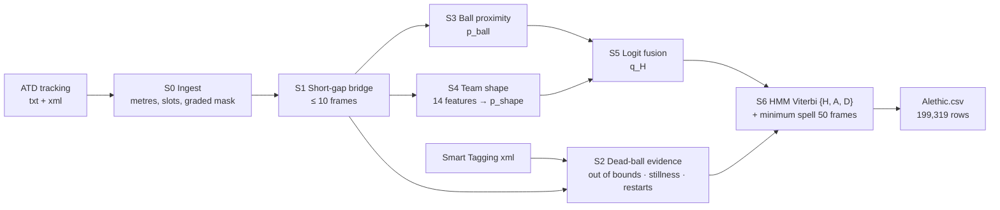

# Possession Spells from Tactical Tracking: a Hidden Markov Model with Team-Shape Priors for Ball Gaps

**Team:** Alethic · **Challenge:** More Than A Hack 2027, Initial Challenge (tactical possession) · **Date:** November 2026\
**Code:** the public repository submitted with this document (it contains no match data)

> **Key results**
>
> - **Development set** (5 public IDSSE matches, nested leave-one-match-out): out-of-fold spellF1 rises from **0.457 to 0.504** (+0.047), and the gain is positive in **5 of 5** held-out matches.
> - **Where the gain comes from:** better team assignment while the ball is not tracked. Gap-frame accuracy rises from 0.80 to 0.84, in 5 of 5 matches.
> - **Provided game (public 5 minutes, sanity check only):** spellF1 0.5375 and macroF1 0.8118, in the same direction as the development set.
> - **No hand labels and no human-produced data about the provided game.** The algorithm is deterministic and CPU-only, and one command regenerates the submitted file.

## Summary

We label every frame of the provided game as home possession (H), away possession (A) or dead ball (D). The inputs are the automatic tactical tracking and Metrica's automatic Smart Tagging.

**The main difficulty is the ball.** It is untracked on 40.7% of graded frames (64,643 of 158,857). A nearest-player rule therefore has nothing to say for long stretches, and turnovers that happen while the ball is missing are found late or not at all.

**Our pipeline has five parts:**

1. **Dead-ball evidence.** It is declared only from positive physical evidence: the ball out of bounds, players collectively standing still, or Smart Tagging set-piece and goal restarts. A missing ball alone is never treated as dead.
2. **A ball-proximity model** for frames where the ball is visible.
3. **A 14-feature team-shape model** that estimates who has the ball from the two teams' formations when the ball is missing.
4. **Logit-space fusion** of the two models. It reduces exactly to the ball-only baseline when the shape weight is zero.
5. **A three-state HMM decoder** with Viterbi decoding and a minimum spell length.

**How we trained and selected.** Every learned weight and every selected parameter comes from five other matches in the public IDSSE dataset, under nested cross-validation. The provided game's public five minutes were read only to check that the pipeline works end to end, never to choose anything.

## 1. Task and metric

The provided game, BAR-ATH, has 199,319 frames at 25 Hz. Of these, 158,857 are graded: frames 11185–90651 in the first half and 110808–190197 in the second.

| Label | Meaning |
|:---:|:---|
| `H` | Home team (FC Barcelona) in possession |
| `A` | Away team (Athletic Club) in possession |
| `D` | Dead ball: out of play, set-piece setup, or another stoppage |
| `X` | No ground truth or abstain. It is never scored in the ground truth, and counts as a miss if predicted on a graded frame. |

**Our output.** We write `H`, `A` or `D` on every graded frame and never `X`. On ungraded frames we write `D`; those frames are not scored.

**How submissions are ranked.**

- **SpellF1 (the ranking metric).** A possession spell is a maximal run of `H` or of `A`. Predicted spells are matched one-to-one to true spells of the same team by temporal IoU. SpellF1 is the F1 averaged over the IoU thresholds {0.3, 0.4, 0.5, 0.6, 0.7}; the 0.5 value is reported as the headline.
- **MacroF1 (the first tie-break).** The per-frame F1 over {H, A, D}, as defined in the organisers' `evaluation/possession_metrics.py`.

## 2. Assets used and dropped

| Asset (provided game) | Used? | How |
|:---|:---:|:---|
| Automatic tactical tracking, `BAR-ATH_tactical_atd.txt` | **Used** | Player and ball positions, the algorithm's only per-frame input |
| Tracking metadata, `BAR-ATH_tactical_atd.xml` | **Used** | Pitch size, frame timing, team of each tracking slot |
| Metrica's automatic Smart Tagging, `BAR-ATH_tactical_smart_tagging.xml` | **Used** | Start times of `SET PIECES` and `GOALS` tags, as dead-ball evidence |
| Tactical and broadcast video | Dropped | Not read |
| Homography | Dropped | Not read, because tracking is already in pitch coordinates |
| Public 5-minute ground truth | Check only | Read to confirm the pipeline runs end to end (Section 7). Never used to train, tune or select. |

The challenge data notes describe Smart Tagging as Metrica's automatic tactical annotation, generated without manual review, and the FAQ invites teams to use it. We use it only as an algorithmic input. No hand labels, no human-produced event data and no private ground truth for the provided game were used at any point.

## 3. Training and development data

**Source.** All training and tuning uses five complete Bundesliga matches from the public **IDSSE** dataset (Sportec/DFL tracking, CC BY 4.0): `J03WMX`, `J03WOH`, `J03WOY`, `J03WPY` and `J03WQQ`. None of them is the provided game.

**Making IDSSE look like the challenge data.** IDSSE tracking is clean and identity-labelled, so we degraded it to match the challenge statistics, using `mtah2027/degradation.py`:

- **Density-dependent ball dropout,** giving about 40.7% missing ball frames, as in the provided game;
- **Anonymous tracklet fragmentation,** with a mean tracklet lifetime of 15 s.

**Development reference.** Training labels come from the DFL possession data under a controlled hold rule ($T_{\text{hold}} = 1.5$ s, i.e. 38 frames), aligned to the challenge's possession convention. The raw, unsmoothed DFL possession is kept as a sensitivity check.

**Held-out matches.** Two further IDSSE matches (`J03WN1`, `J03WR9`) are reserved for an unrelated study. The data loaders refuse them (`mtah2027/kloppy_prep.py`, `train_shape_model.py`), and they were never used to train or select this model.

## 4. Approach

<!-- PIPELINE-DIAGRAM -->

<!-- /PIPELINE-DIAGRAM -->

**S0: Ingest.**

- We read the ATD positions and metadata, in metres, with the pitch size taken from the XML.
- Each tracking slot is assigned to its team; the home attack direction is inferred for each half (used in S4).
- We build the graded-frame mask.

**S1: Short-gap bridge.** Ball gaps of up to 10 frames (0.4 s) are filled by constant-velocity linear interpolation. Longer gaps stay unobserved and are handled by S4.

**S2: Dead-ball evidence.** $p_D$ is the per-frame probability that the ball is dead. It starts at a base value of 0.02 and is raised only by positive evidence:

| Evidence | Trigger | $p_D$ |
|:---|:---|:---:|
| Out of bounds | The ball is more than 0.5 m beyond a line for 3 or more frames, or for 1 frame followed by a gap of 10 or more frames | 0.85 |
| Collective stillness | Mean outfield speed is 1.2 m/s or less for 50 or more frames (2 s) | 0.90 |
| Smart Tagging restart | The window [start − 2 s, start] of each `SET PIECES` or `GOALS` tag | 0.85 |

A missing ball on its own never raises $p_D$. This prevents long passes and occlusions from being labelled dead.

**S3: Ball proximity.**

- On frames with a ball position, $d_H$ and $d_A$ are the distances from the ball to the nearest tracked player of each team.
- Player positions are first smoothed with a Savitzky–Golay filter (window 7, order 2).
- Then $p_{\text{ball}} = \sigma\big((d_A - d_H)/r\big)$, with $r = 1.5$ m.

**S4: Team shape.** When the ball is missing, the two formations still show who has it. The team in possession spreads wide and pushes up; the defending team compresses. From anonymous outfield tracklets we compute 14 identity-free features:

- the longitudinal centroid and centroid velocity of each team, signed by attack direction (4 features);
- the ratios of team width (10th–90th percentile spread) and team length (2);
- the defensive-line height of each team, measured at the second-deepest outfield player (2);
- each team's share of players in the opponent half (2);
- the difference in radius of gyration (1);
- the ball's last position, the sign of its last owner, and the elapsed gap time, capped at 15 s (3).

An L2-regularised logistic regression ($\lambda = 1$, fitted by IRLS with 50 iterations and tolerance $10^{-6}$, on standardised features) gives $p_{\text{shape}} = P(H \mid \mathbf z_t)$. The weights are in `results/shape_weights.json`.

**S5: Logit-space fusion.** With $q_A = 1 - q_H$:

| Frame type | Fused home probability $q_H$ |
|:---|:---|
| Ball observed | $\operatorname{logit} q_H = \alpha \operatorname{logit} p_{\text{ball}} + (1-\alpha) \operatorname{logit} p_{\text{shape}}$ |
| Ball missing | $\operatorname{logit} q_H = \gamma \operatorname{logit} p_{\text{shape}}$ |

With $\alpha = 1$ and $\gamma = 0$, this reduces exactly to the ball-only model ($q_H = 0.5$ on gap frames), so the shape prior is a strict extension of the baseline.

**S6: Decoding.**

- **Emissions:** $P(\mathbf y_t \mid H) = (1-p_D)\,q_H$, $P(\mathbf y_t \mid A) = (1-p_D)\,q_A$, and $P(\mathbf y_t \mid D) = p_D$.
- **Viterbi decoding** over the transition matrix below. Its low turnover probability stops duel flicker from creating spells.
- **Minimum spell:** any `H` or `A` run shorter than 50 frames (2 s) is merged into its neighbours.

Transition probabilities per frame ($p_t$ turnover, $p_d$ ball goes dead, $p_r$ restart):

| From → to | `H` | `A` | `D` |
|:---:|:---:|:---:|:---:|
| `H` | $1-p_t-p_d$ | $p_t$ | $p_d$ |
| `A` | $p_t$ | $1-p_t-p_d$ | $p_d$ |
| `D` | $p_r/2$ | $p_r/2$ | $1-p_r$ |

**Frozen parameters** (`results/frozen_params.json`):

| Parameter | Value | Selected by |
|:---|:---:|:---|
| Turnover $p_t$, ball goes dead $p_d$, restart $p_r$ (per frame) | 0.01, 0.02, 0.02 | IDSSE grid of 108 configurations, match-grouped CV |
| Stillness speed and duration | 1.2 m/s, 50 frames | same grid |
| Minimum spell | 50 frames | same grid, {50, 75, 100, 125} |
| Short-gap bridge, dead-ball evidence $p_D$ | 10 frames, 0.85 | fixed a priori |
| Fusion weights $\alpha$, $\gamma$ | 0.6, 0.1 | nested LOMO (Section 6) |

## 5. Possession rules implemented

| Rule | Implementation |
|:---|:---|
| A team is in possession while the ball is alive and it controls the ball | `H`/`A` from S3 when the ball is seen, and from S4 plus ball memory when it is not |
| The ball is dead when out of play or during a restart or stoppage | `D` from S2: out of bounds, collective stillness, set-piece and goal restarts |
| A missing ball does not mean the ball is dead | S2 never uses ball absence as evidence |
| Momentary touches or duels do not change possession | HMM turnover probability $p_t = 0.01$ per frame, plus the minimum spell of 50 frames |
| A spell never crosses half-time | Half-time and other ungraded frames are written as `D`, and shape features are computed separately for each half |
| Every graded frame gets a label | No `X` on graded frames, enforced as an assertion in `make_submission.py` |

## 6. Validation and results

**Protocol.** We use nested leave-one-match-out cross-validation on the five IDSSE matches.

- **Inner loop:** in each outer fold, the shape model and the $(\alpha, \gamma)$ grid ($\alpha \in [0.6, 1.0]$, $\gamma \in [0, 0.5]$) are fitted and tuned on the other four matches only, by an inner 4-fold CV.
- **Outer loop:** the held-out match is scored strictly out of sample.
- **Final parameters:** the final pair is the modal fold choice. Ties are broken by mean inner out-of-sample spellF1, and this rule was fixed before the folds were run.

**Results by fold.** M2 is the ball-only model and M3 adds the team-shape prior.

| Fold | Held-out match | Selected $(\alpha,\gamma)$ | M2 spellF1 | M3 spellF1 | Δ (aligned ref.) | Δ (raw DFL ref.) |
|:---:|:---:|:---:|:---:|:---:|:---:|:---:|
| 1 | `J03WMX` | (0.6, 0.1) | 0.4949 | 0.5214 | +0.0266 | −0.0043 |
| 2 | `J03WOH` | (0.6, 0.4) | 0.4716 | 0.4726 | +0.0010 | −0.0113 |
| 3 | `J03WOY` | (0.6, 0.5) | 0.3958 | 0.4945 | +0.0987 | +0.0713 |
| 4 | `J03WPY` | (0.6, 0.1) | 0.4595 | 0.5348 | +0.0753 | +0.0499 |
| 5 | `J03WQQ` | (0.6, 0.0) | 0.4648 | 0.4970 | +0.0322 | +0.0151 |
| **Mean** | | **modal (0.6, 0.1)** | **0.4573** | **0.5041** | **+0.0468** (SD 0.0394) | **+0.0241** |

**What drives the gain:**

- **Gap-frame accuracy** (live frames with no ball) improves in 5 of 5 folds: from 75.3–81.6% for M2 to 81.7–85.4% for M3.
- **Turnovers during gaps:** recall improves in 3 of 5 folds (up to 38.0%), with a mean boundary timing error of 0.40–0.56 s (10–14 frames).
- **Ablation:**
  - collective outfield shape alone (11 features, no ball memory) reaches 0.4750, which is +0.0177 over M2;
  - the three ball-memory features add a further +0.0291.

## 7. Public five-minute checks

The public slice (`BAR-ATH_possession_gt_public.csv`) covers 7,500 frames and 17 possessions, so its noise floor is about ±0.1 spellF1.

- We allowed ourselves one read per milestone, under a hard cap of five reads enforced in code (`inspect_public_read_quota` in `make_submission.py`).
- No read was used to pick a model or a parameter.

| Milestone | Change | spellF1 | spellF1 @ IoU 0.5 | macroF1 | Alive/dead F1 |
|:---|:---|:---:|:---:|:---:|:---:|
| M0 | Smoothed baseline | 0.4242 | — | 0.5812 | — |
| M1 | Controller + stillness | 0.4324 | 0.4865 | 0.6631 | 0.8924 |
| M2 | Dead-ball evidence (S2) | 0.4457 | 0.5143 | 0.7601 | 0.9262 |
| M3 | Shape fusion (0.8, 0.3) | 0.5294 | 0.5882 | 0.8101 | 0.9320 |
| M4 | Wider grid (0.6, 0.1), **frozen** | **0.5375** | **0.6250** | **0.8118** | **0.9367** |
| M5 | Frozen file re-scored | 0.5375 | 0.6250 | 0.8118 | 0.9367 |

M4 and M5 score the same CSV, byte for byte. The change from M3 to M4 came from widening the $\alpha$ grid on IDSSE, where $\alpha$ had hit its lower bound. It did not come from the public read.

## 8. Limitations

1. **The public check is small.** It covers one match and 17 possessions (about ±0.1). It shows the direction of the effect, not a ranking.
2. **The result depends on the reference definition.** Against the raw DFL reference, the mean gain falls to +0.0241, with 3 of 5 folds positive, because the boundary-smoothing convention matters.
3. **Grid boundaries and identifiability:**
   - $\alpha$ sat on the lower edge of its grid in every fold, which suggests that ball-proximity probabilities are over-confident;
   - $\gamma$ is weakly identified (fold choices range from 0.0 to 0.5);
   - the modal pair had the lowest inner score among the selected pairs;
   - several HMM and dead-ball parameters also sit on grid edges.

   We did not widen any grid further, to avoid chasing the boundary.
4. **Simulated degradation.** Synthetic dropout and fragmentation on Bundesliga tracking cannot reproduce Metrica-specific occlusion geometry, ball loss during camera pans, or tracking artefacts.
5. **Truncated halves in development.** Halves were truncated at 65,000 frames (about 43 min) for uniform arrays, so late and stoppage-time play was not used in training. The provided game is labelled in full.

## 9. Reproduction

You need Python 3.13 and a CPU (no GPU or network access at inference), plus the challenge data bundle stored locally, outside the repository.

```bash
python3.13 -m venv .venv && . .venv/bin/activate
pip install -r requirements.txt     # pinned: numpy, pandas, scipy, kloppy
python3 make_submission.py \
  --atd-txt   <data>/BAR-ATH_tactical_atd.txt \
  --atd-xml   <data>/BAR-ATH_tactical_atd.xml \
  --smart-xml <data>/BAR-ATH_tactical_smart_tagging.xml \
  --out-csv   results/Alethic.csv
python <challenge-repo>/evaluation/validate_submission.py results/Alethic.csv
sha256sum results/Alethic.csv
```

- **Expected output:** 199,320 lines (a `frame,label` header and 199,319 rows), with SHA-256 `eb3eae2eef4545b6f9aa06d237215f02f6b4ebbfdca7e8d686826e20ad2805f3`. That is the submitted file.
- **Don't pass any override flag.** The frozen parameters and shape weights in `results/` are loaded by default.
- **Retraining the shape weights from public IDSSE data:**
  ```bash
  python3 train_shape_model.py --sportec-dir <idsse_dir> --out-weights results/shape_weights.json
  ```
  This reproduces the committed `results/shape_weights.json` byte for byte (SHA-256 `1d9837e4…fec1bb`). We checked this on all ten development halves.
- **Integrity check:** `sha256sum -c SUBMISSION_MANIFEST.sha256` verifies every file in the repository.

## 10. Data, software and attribution

- **IDSSE:** Bassek, M., Rein, R., Weber, H. and Memmert, D. (2025). *An integrated dataset of spatiotemporal and event data in elite soccer.* Scientific Data 12, 195. <https://doi.org/10.1038/s41597-025-04505-y>. Licensed CC BY 4.0.
- **Challenge data:** the automatic tactical tracking and Metrica's automatic Smart Tagging for BAR-ATH, used under the MTAH 2027 participation terms. None of it is redistributed in the repository, and neither is any frame-level derivative.
- **External data:** we asked the organisers to confirm that public external tracking (IDSSE) may be used for training: [issue #16](https://github.com/metrica-sports/more-than-a-hack-2027/issues/16).
- **Software:** [kloppy](https://github.com/PySport/kloppy) 3.19.0 (MIT) for public tracking ingest. The organisers' evaluation code is vendored unmodified in `third_party/mtah2027/` under its MIT licence. Our code is MIT-licensed.
